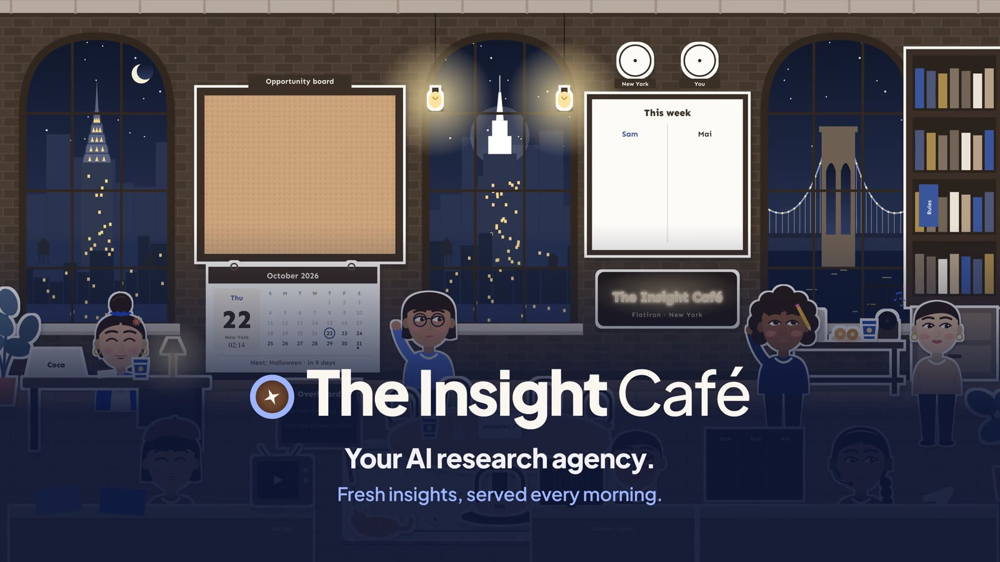

# The Insight Café · trial

**Your AI research agency. Fresh insights, served every morning.**

Every morning you open 47 tabs to answer three questions: what's trending, what are my competitors doing,
what should we make next? The Insight Café is a small AI agency that does that research for you, drawn as an
illustrated office where each specialist (all named after drinks) has one job.

This is the free trial. It runs on your computer, on your own Anthropic API key, for any brand, shop or service.



## What the trial does

Four of the seven specialists work in the trial:

| | Job | What you get |
|---|---|---|
| **Espresso** | Spots what's trending | The culture radar: 3-5 moves that matter to you, with proof and pictures, plus what people think, feel and buy around the next occasions |
| **Chai** | Watches your competitors | What they launched, said and did in the news, and what you can steal or must answer |
| **Matcha** | Ranks what's worth doing | Every opportunity scored on fit, momentum, reach, urgency and ease: *Act today*, *This week*, *Watch* or *Skip* |
| **Coca** | Writes your summary | One page: the answer first, three findings, who does what next |

Then the studio writes the strongest idea up as a full play for your team: hooks, the approach, tactics and
real references.

It reads free, public sources: news, Google Trends, the holiday and occasion calendar, your competitors in the
news, Pinterest and your own product catalogue. Nothing is posted anywhere; the office reads, it never writes.

## What the full Insight Café adds

The other rooms are in the office too, locked:

| | In the trial | In the full office |
|---|---|---|
| Specialists | 4 of 7 | All 7, including **Mocha** (studies competitors' Facebook and Instagram ads, then drafts yours) and **Latte** (reads your reviews on your website and Amazon, word for word) |
| Plays | The top one, written in full | Every play, and **Tonic** sends each one to its owner on Slack |
| Learning | — | The morning huddle: the crew asks you one question each and learns your taste |
| Sources | News, Google Trends, the calendar, Pinterest | Plus Instagram, TikTok, YouTube, Reddit and the competitor ad spy |
| Runs | When you run it, on your computer | 24/7 in the cloud, two reports a day, a private office page your whole team opens |

Follow me on TikTok: [@himeline](https://www.tiktok.com/@himeline)

## Quick start

You need [Claude Code](https://claude.com/claude-code) or Python 3.10+, and an
[Anthropic API key](https://console.anthropic.com/settings/keys). A report costs about $1 of Claude and takes
a few minutes.

### With Claude Code (easiest)

Inside Claude Code, run:

```
/plugin marketplace add melinenguyen/insight-cafe
/plugin install insight-cafe@insight-cafe
```

Then say: *"Set up my Insight Café."* Claude opens the setup form, builds your office and walks you through
the first report.

### By hand

1. [Download this repository](https://github.com/melinenguyen/insight-cafe/archive/refs/heads/main.zip) and
   unzip it. Everything lives in `skills/insight-cafe/`.
2. Open `skills/insight-cafe/dashboard/index.html` in your browser. Fill in your brand (or press **Load the
   example**), then export `profile.json` into `skills/insight-cafe/`.
3. Build your office:
   ```bash
   cd skills/insight-cafe
   python3 scripts/scaffold.py --profile profile.json --out ~/Desktop/my-insight-cafe
   ```
4. Paste your API key into `~/Desktop/my-insight-cafe/agency/.env`.
5. Run your first report:
   ```bash
   cd ~/Desktop/my-insight-cafe
   python3 -m pip install -r agency/requirements.txt
   python3 -m agency.run
   ```
   The office opens in your browser. Run it again whenever you want a fresh report.

Free commands: `python3 -m agency.run --scouts` shows what the scouts find right now; `--rebuild` redraws the
office from the last report.

## Your data

Everything stays on your computer: your profile, the office, the memory and your API key (in `agency/.env`,
which is never committed). The only calls out are to public sources and to the Claude API with your key.

## Tiếng Việt

The Insight Café là một agency nghiên cứu AI nhỏ, được vẽ thành một văn phòng: mỗi chuyên viên (đều mang tên đồ
uống) làm một việc. Bản dùng thử chạy trên máy của bạn với API key Anthropic của bạn, cho mọi thương hiệu,
cửa hàng hay dịch vụ. Bốn chuyên viên làm việc: Espresso (xu hướng), Chai (đối thủ), Matcha (chấm điểm cơ
hội), Coca (bản tóm tắt buổi sáng). Form thiết lập có tiếng Việt: mở `skills/insight-cafe/dashboard/index.html` và chọn **VI**.

---

Made by Méline Nguyen ([@himeline](https://www.tiktok.com/@himeline)). The example brands are made up.
Built with [Claude](https://www.anthropic.com/claude).
See [LICENSE](LICENSE).
