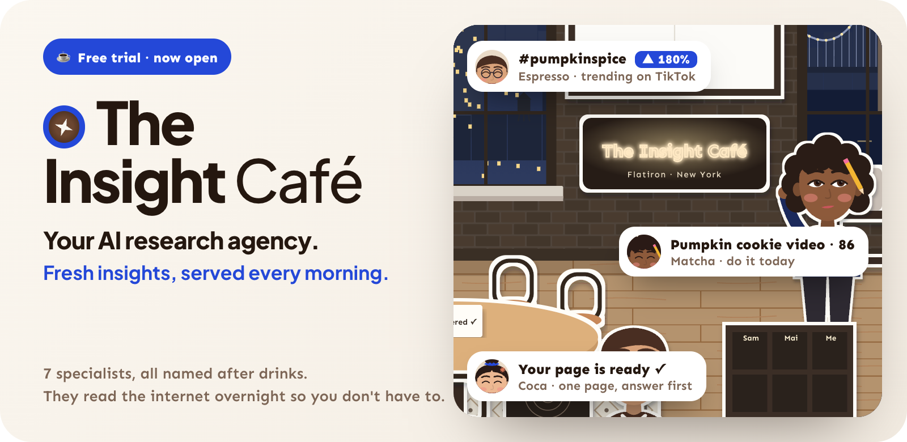
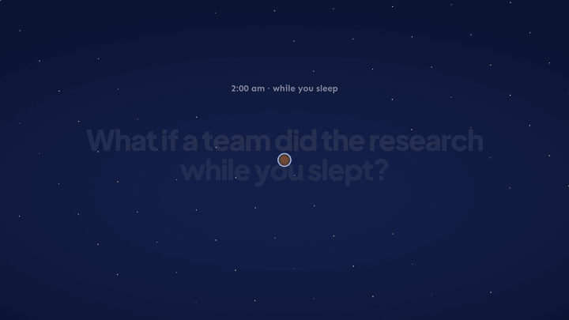
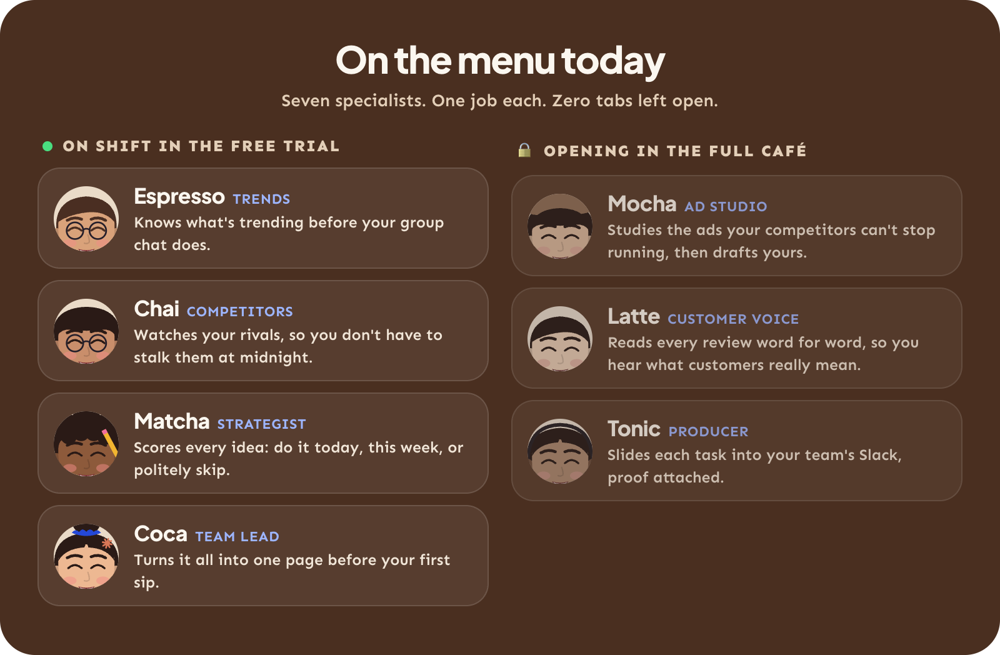
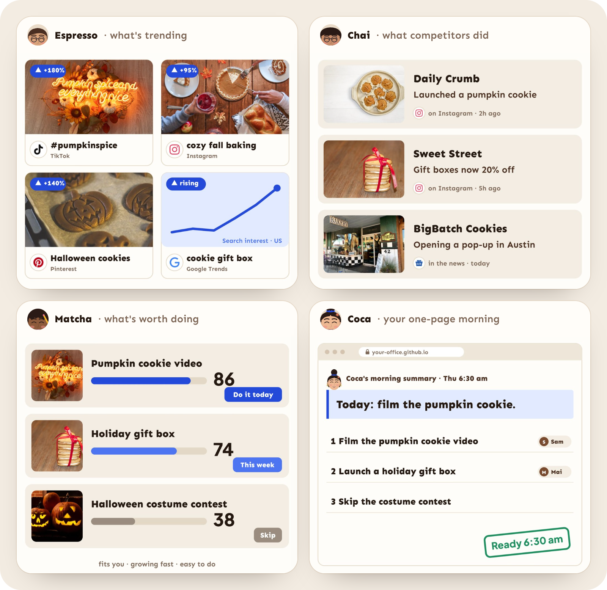
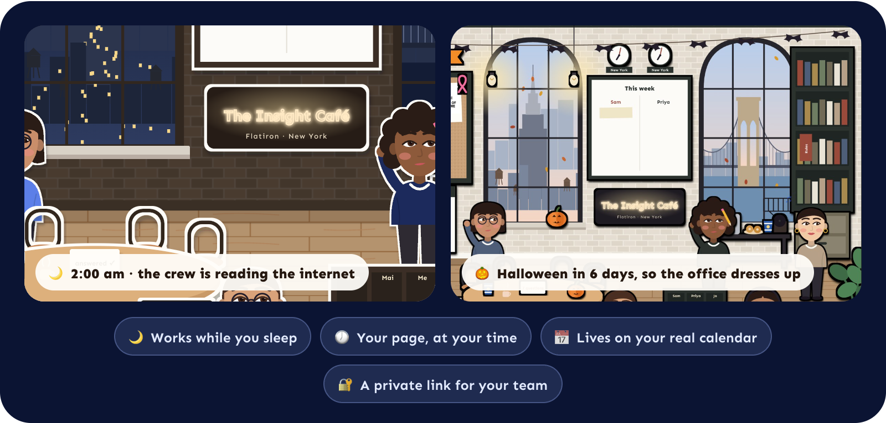
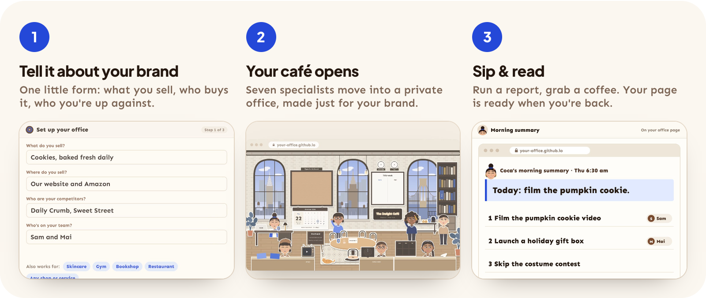
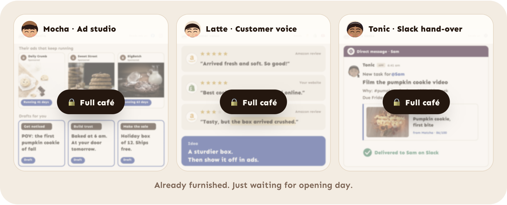

<p align="center">
  
</p>

<p align="center">
  <a href="#-order-in-two-lines"></a>
  
  
</p>

<h3 align="center">Less searching. More time to sip your coffee.</h3>

<br>

Hi, I'm **Méline**: a brand marketer, not a developer. 👋

Every morning I asked myself the same three questions. *What's trending? What are my competitors up to? What
should we make next?* By 11:48 I had 47 tabs open, zero answers and a very cold latte.

So I opened a café. ☕

**The Insight Café** is a tiny AI research agency, drawn as an office, with seven specialists who are (obviously)
all named after drinks. They do the digging around the clock and serve you **one page**: the answer first, the
proof right beside it, and who should do what next. This is the **free trial**, so four of them are on shift.

<p align="center">
  
  <br>
  <sub>🎬 <a href="https://github.com/melinenguyen/insight-cafe/releases/download/v0.1.0/the-insight-cafe-film.mp4">Watch the full one-minute film, with sound</a></sub>
</p>

## 🥐 Meet the crew



## 🍽️ What lands on your table


<sub>Shown with the full café's social scouts switched on. The trial reads the news, search trends and the calendar.</sub>

Proof and pictures, never vibes:

- 📈 **Trends you can see.** What's rising in the news, in search and around the next holidays, with the stories to prove it.
- 👀 **Competitors, minus the midnight stalking.** What they launched and announced in the news this week, and what you can steal.
- 🎯 **A ranked to-do list.** Every idea scored on fit, momentum, reach, urgency and ease: *do it today*, *this week*, or *politely skip*.
- 📝 **One page.** The answer first, three findings, who does what. Then the best idea is written up as a ready-to-shoot brief: hooks, the plan, references.

Works for any brand, shop or service: skincare, bakeries, gyms, bookshops… If you have competitors and customers, you have a café.

## 🌙 Open 24/7, live with your calendar



Put your café on GitHub (free) and it never closes. The crew brews your report at the times you pick, your office
stays online behind a passphrase, and the whole place runs on real time: day turns to night outside the windows,
the clocks tick in your city, and the décor follows your calendar. Pumpkins for Halloween, lights for the holidays,
a countdown to every occasion that matters to your brand. Nobody's laptop needs to be on.

Rather keep it on your laptop? That works too. Run a report whenever you like.

## 🧾 Order in two lines

Got [Claude Code](https://claude.com/claude-code)? Paste these:

```
/plugin marketplace add melinenguyen/insight-cafe
/plugin install insight-cafe@insight-cafe
```

Then just say: **"Set up my Insight Café."**

Claude hands you a little form about your brand, sets up your café and pours your first report. Love it? Say
**"Open my café 24/7"** and Claude walks you through putting it on GitHub. It takes about fifteen
minutes to set up (a little longer if you love filling forms), and each report costs about $1 of Claude on your own
[Anthropic API key](https://console.anthropic.com/settings/keys).



<details>
<summary><b>No Claude Code? Brew it by hand ☕</b></summary>
<br>

You'll need Python 3.10+ and an [Anthropic API key](https://console.anthropic.com/settings/keys).

1. [Download this repo](https://github.com/melinenguyen/insight-cafe/archive/refs/heads/main.zip) and unzip it.
2. Open `skills/insight-cafe/dashboard/index.html` in your browser. Fill in your brand (or press **Load the example**)
   and export `profile.json` into `skills/insight-cafe/`.
3. Set up your café:
   ```bash
   cd skills/insight-cafe
   python3 scripts/scaffold.py --profile profile.json --out ~/Desktop/my-insight-cafe
   ```
4. Paste your API key into `~/Desktop/my-insight-cafe/agency/.env`.
5. Brew your first report:
   ```bash
   cd ~/Desktop/my-insight-cafe
   python3 -m pip install -r agency/requirements.txt
   python3 -m agency.run
   ```

Your office opens in the browser. Run it again whenever you want a fresh pot. (`--scouts` peeks at what the crew
found without spending anything; `--rebuild` redraws the office.)

**Open it 24/7 on GitHub (free):**

1. In the setup form, fill in **Schedule & delivery**: your report time(s) and two repo names, one private (the
   café's brain) and one public (the office page). Export and set up your café again.
2. Push the café folder to the **private** repo. Create the **public** one and switch on GitHub Pages
   (Settings → Pages → deploy from `main`, root).
3. In the private repo → Settings → Secrets and variables → Actions, add `ANTHROPIC_API_KEY`, `AGENCY_PASSPHRASE`
   (the office's lock, for your team) and `PUBLISH_TOKEN` (a fine-grained token with *Contents: read and write* on
   the public repo).
4. Actions → Run workflow → slot `morning`. A few minutes later your office is live, and it reports on its own
   every day after that.

</details>

## 🔒 The full café (coming soon)

Three rooms are already furnished. They're just waiting for opening day.



| | ☕ Free trial | ✨ Full café |
|---|---|---|
| **The crew** | Espresso, Chai, Matcha, Coca | All seven, with **Mocha** (your competitors' ads, then yours) and **Latte** (every review, word for word) |
| **Ideas written up** | The best one | All of them, and **Tonic** slides each one into your team's Slack |
| **Learns your taste** | Not yet | A morning huddle: the crew asks you one question each and remembers your answers |
| **Where it looks** | News, search trends, the calendar, Pinterest | Plus Instagram, TikTok, YouTube, Reddit and a 24/7 ad spy |
| **When it works** | 24/7 on GitHub, live with your calendar, one or two reports a day (or whenever you press go) | Plus a 24/7 ad spy that checks your competitors' new ads every two hours |
| **Report archive** | The latest report | Every report kept, so you can see what changed |

Want a seat on opening day? Follow me on TikTok [@himeline](https://www.tiktok.com/@himeline). ☕

## 🍵 Little FAQ

**Do I need to code?**
Nope. If you can copy and paste two lines, you can run a café.

**What does it cost?**
The café is free. Claude charges about $1 per report, billed to your own Anthropic account, so one report a day is
about $30 a month. No subscription, no surprise bill from me.

**Does it really work while I sleep?**
Yep. On GitHub the café checks the clock every hour and brews your report at your time. That fits inside GitHub's
free plan, and nobody's computer needs to be on.

**Is my brand info safe?**
On your laptop, everything stays on your computer. On GitHub, your brand profile and the café's memory live in your
**private** repo, your API key sits in its encrypted secrets, and the office page is encrypted: only people with
your passphrase can open it.

**Will it post or DM anyone for me?**
Never. The crew only reads public stuff. It doesn't post, like, follow or slide into anyone's DMs.

**Can I make it speak Vietnamese?**
Yes. The setup form is in English and Vietnamese, and your reports can be written in whatever language your team
speaks.

## 🇻🇳 Cho các bác người Việt

The Insight Café là một agency nghiên cứu AI tí hon, được vẽ thành văn phòng với 7 "nhân viên" tên đồ uống. Mỗi
sáng chỉ cần một trang: đang trend gì, đối thủ làm gì, nên làm gì trước, ai làm. Bản dùng thử miễn phí có 4 bạn
đi làm (Espresso, Chai, Matcha, Coca), mở cửa 24/7 trên GitHub (miễn phí) và sống theo lịch thật: ngày đêm, giờ
giấc, Halloween hay Tết là văn phòng tự đổi đồ. Hoặc chạy ngay trên máy các bác cũng được. Form thiết lập có tiếng Việt: chọn **VI** là xong.
Chúc các bác ít tab hơn, nhiều cà phê hơn ☕

<br>

<p align="center">
  <sub>Brewed with ☕ by <b>Méline Nguyen</b>, a marketing girlie who explores opportunities and builds brands she loves.<br>
  Follow me on TikTok <a href="https://www.tiktok.com/@himeline">@himeline</a> · The example brands are made up · Built with <a href="https://www.anthropic.com/claude">Claude</a> · <a href="LICENSE">License</a></sub>
</p>
